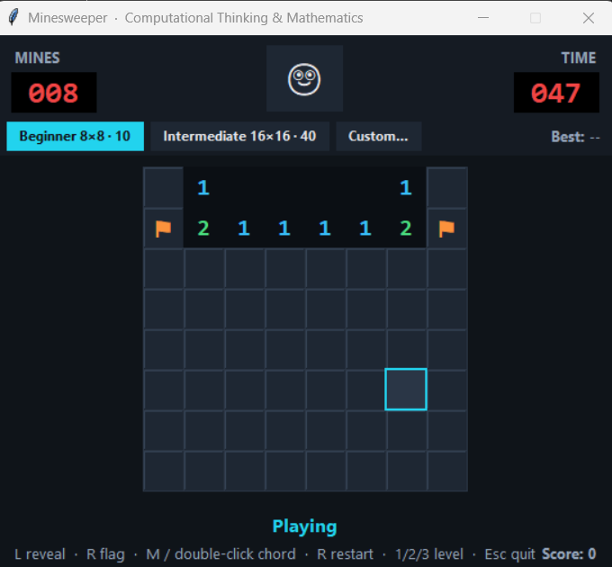

# Minesweeper — Computational Thinking & Mathematics

A complete, playable Minesweeper game written in **Python 3** with **Tkinter**
only. The project is split into a pure game model, a Tkinter view, an entry
point and a unit-test suite. It uses a dark “neon on charcoal” theme with
animated flood fill, chording, a timer, session best times and a score.



*Screenshot placeholder: this image was captured from the running app. Replace
`screenshot.png` with your own image if you change the theme.*

---

## 1. How to run

```bash
cd minesweeper
python main.py
```

Python **3.10+** is recommended because the code uses modern type hints and
`dataclass(slots=True)`. Tkinter ships with the standard Windows/macOS Python
installer. On some Linux distributions you may need the separate system
package, for example `sudo apt install python3-tk`.

### Run the tests

From the `minesweeper` folder:

```bash
python -m unittest -v
```

The tests are headless: they never create a Tkinter window.

---

## 2. Controls

| Action | Control |
|---|---|
| Reveal a cell | Left click |
| Flag / unflag | Right click |
| Chord a revealed number | Middle click **or** double-click |
| Restart current difficulty | `R` or the 🙂 button |
| Beginner 8×8 / 10 mines | `1` |
| Intermediate 16×16 / 40 mines | `2` |
| Custom difficulty dialog | `3` |
| Quit | `Esc` |

The timer starts on the **first reveal**, not when the window opens. The
mines-remaining LED shows `010`, `009`, … and is capped so it never becomes
negative. The best time is kept per difficulty for the current session.

---

## 3. Features

- Beginner 8×8 with 10 mines (default), Intermediate 16×16 with 40 mines, and
  a validated Custom mode.
- First click is always safe: if it lands on a mine, that mine is moved.
- Classic zero-region flood fill implemented iteratively with BFS.
- Animated expanding flood-fill waves (25 ms per layer).
- Hover highlight, click flashes, loss animation with a window shake, and a
  win overlay with time and score.
- Correct flags, wrong flags (amber crossed-out flags after a loss), green mines
  after a win, and a bright red highlight on the clicked mine.
- Timer, score and per-difficulty session best time.
- Keyboard shortcuts and a custom dark Tkinter theme.
- All colours, fonts, sizes, limits and animation delays are in the single
  `THEME` dictionary at the top of `gui.py`.

### Custom-mode limits

For a window that fits on a typical laptop screen, Custom rows and columns are
limited to **3–20** and mines to **1–(rows × cols − 1)**. The upper mine bound
leaves at least one safe cell, which is required for the first-click guarantee.

---

## 4. Project structure

```text
minesweeper/
├── cell.py        # Cell abstraction: four properties only
├── board.py       # All game logic; no Tkinter imports
├── gui.py         # Tkinter drawing, events, animations, THEME
├── main.py        # Entry point: python main.py
├── test_board.py  # unittest suite for the game model
├── README.md      # This file
└── screenshot.png # Screenshot placeholder / example capture
```

The important dependency rule is:

```text
gui.py  ──uses──>  board.py  ──uses──>  cell.py
```

`board.py` never imports Tkinter. `gui.py` never decides whether a move wins,
how many mines surround a cell, or which cells a flood fill should open.

---

## 5. The five Computational Thinking pillars

| CT pillar | Where it appears | Why it is needed |
|---|---|---|
| **Decomposition** | `cell.py` (one cell), `board.py` (rules), `gui.py` (view), `main.py` (entry); inside `Board`: construction, mine placement, neighbours, counting, reveal, flagging, chording, win/loss | A large problem becomes small, testable pieces. The model can be tested without a screen, and the UI can be restyled without changing rules. |
| **Pattern Recognition** | `Board._OFFSETS` and `Board.get_neighbours()`; one number-colour rule; one `_draw_cell()` path for every cell | Every cell uses the same eight-direction neighbourhood rule and the same drawing logic. Corners, edges and middle cells differ only by the boundary check. This removes duplicated code and makes behaviour consistent. |
| **Abstraction** | `Cell` stores only `is_mine`, `is_revealed`, `is_flagged`, `adjacent_mines`; `Board.reveal()` returns animation waves; `gui.py` sees only public state | The GUI does not need to know how mines are placed or how BFS works. The model hides the algorithm behind a small, clear interface. |
| **Algorithmic Thinking** | Random placement loop with `mine_set`; iterative BFS flood fill; animation scheduler using `root.after`; timer and score | The rules must become a precise sequence of steps. BFS avoids recursion limits and produces the expanding waves used by the animation. `root.after` keeps the event loop responsive. |
| **Logical Reasoning** | First-click relocation; flag restrictions; chord condition `flags_around == adjacent_mines`; win condition `revealed_count == rows*cols - num_mines` | The game state must follow exact Boolean rules. These conditions prevent impossible moves and decide when the game is won, lost, or eligible for a chord. |

### Where each pillar is visible in the code

- **Decomposition** — `board.py` has separate methods for `_place_mines_randomly`,
  `get_neighbours`, `count_adjacent_mines`, `reveal`, `_flood_fill_zero_region`,
  `toggle_flag`, `chord` and `_check_for_win`.
- **Pattern Recognition** — the eight offsets are defined once in
  `Board._OFFSETS`; every cell uses the same boundary check.
- **Abstraction** — `Cell` has exactly four properties. The GUI calls
  `Board.reveal`, `Board.toggle_flag` and `Board.chord` rather than manipulating
  cells directly.
- **Algorithmic Thinking** — the BFS queue, the expanding wave dictionary and
  the `root.after` animation chain are all explicit algorithms.
- **Logical Reasoning** — comments such as “a flag is a promise from the
  player” and the single win-condition function make the rules auditable.

---

## 6. Mathematics used

| Mathematical idea | Where it is used | Why it is needed |
|---|---|---|
| **Matrices and indexing** | `board[row][col]`; `_OFFSETS`; `get_neighbours`; canvas coordinates | The board is an M × N matrix. Row/column indexing turns a visual grid into data, and the same coordinates drive both the model and the canvas. |
| **Coordinate geometry** | Eight offsets `(-1,-1) … (1,1)` excluding `(0,0)`; boundary test `0 <= nr < rows` and `0 <= nc < cols` | The neighbours of a cell are exactly the cells at Chebyshev distance 1. The boundary test keeps the game from wrapping around an edge. |
| **Counting / summation** | `count_adjacent_mines`; `Number(r,c) = count of mines in valid 8 neighbours` | The number on a safe cell is a finite sum over its neighbours. This is the central information the player uses to reason. |
| **Sets** | `mine_set: set[(row, col)]`; random placement loop | A set stores unique coordinates, so drawing a coordinate twice cannot create a duplicate mine. This directly enforces the “no duplicate mines” requirement. |
| **Combinatorics / probability** | Random mine placement; first-click relocation | Mines are sampled from the finite set of board coordinates. Moving a mine on the first click preserves fairness while guaranteeing a safe opening. |
| **Graph search (BFS)** | `_flood_fill_zero_region` with a `deque`; wave distances | A zero region is a connected component of the grid graph. Breadth-first search opens the component layer by layer and avoids recursion limits. |
| **Boolean logic** | Win condition; chord condition; flag rules | Winning is the predicate `revealed_count == rows*cols - num_mines`. A chord is allowed only when the flag count around a number equals that number. |
| **Complexity / efficiency** | O(rows × cols) counting and flood fill; O(1) win check using `revealed_count` | Each cell has at most 8 neighbours, so counting is linear in the number of cells. Maintaining a revealed counter avoids recounting the whole board after every move. |
| **Arithmetic and time** | LED timer; best time; score `max(0, mines×100 − seconds×3)` | The timer converts monotonic clock differences into whole seconds. The optional score rewards more mines and faster play. |

### Key formulas written out

```text
Neighbours(r, c) = { (r+dr, c+dc) : dr, dc ∈ {-1,0,1}, (dr,dc) ≠ (0,0),
                     and the result is inside the matrix }

Number(r, c) = Σ [ board[nr][nc].is_mine ]  over all valid neighbours (nr,nc)

Win  ⇔  revealed_count = rows × cols − num_mines

Chord allowed  ⇔  flags_around(r,c) = adjacent_mines(r,c)

Score = max(0, num_mines × 100 − elapsed_seconds × 3)
```

---

## 7. Game rules and model API

The public model methods are deliberately small:

| Method | Purpose |
|---|---|
| `Board(rows, cols, num_mines, seed=None)` | Build the matrix, place mines and calculate all numbers. |
| `Board.from_mine_positions(rows, cols, positions)` | Build a board with known mines for tests and demonstrations. |
| `get_neighbours(r, c)` | Return the valid 8-neighbour list (3 at a corner, 5 on an edge, 8 in the middle). |
| `count_adjacent_mines(r, c)` | Apply the counting formula to one cell. |
| `reveal(r, c)` | Apply all reveal rules; return BFS waves for the animation. |
| `toggle_flag(r, c)` | Flag/unflag a hidden cell; return whether the board changed. |
| `chord(r, c)` | Reveal neighbours when the flags match the number. |
| `is_won()` / `is_lost()` / `is_game_over` | Convenience state predicates. |

On a loss, `Board` marks every mine as revealed and records
`exploded_cell`. The GUI uses that information to animate the mines and
highlight the clicked one. On a win, all safe cells are revealed and the GUI
turns the remaining mine cells green.

---

## 8. Tests

`test_board.py` uses `unittest` and covers:

- 3×3, 5×5 and 10×10 matrix construction.
- Corner = 3, edge = 5, middle = 8 neighbours.
- Adjacent-mine counts on hand-built boards with known mine positions.
- Mine-set uniqueness and the exact mine count.
- First-click safety and mine relocation.
- Flood fill opening a zero region, respecting flags, and never opening mines.
- Win and loss detection.
- Maximum mines (8 mines on a 3×3 board) and a single-mine board.
- Flag counter changes, flag limits, flagging a revealed cell, and clicking a
  flagged cell.
- Chording with matching and non-matching flags.
- Game-state strings and helper predicates.

Run them with:

```bash
cd minesweeper
python -m unittest -v
```

---

## 9. UI architecture and theme

- `gui.py` uses one `tk.Canvas` for the whole grid. Each cell is a rectangle
  plus optional text, glow and flag-crossing lines.
- Every colour and size is in `THEME` at the top of `gui.py`; the fonts and
  animation delays are there too.
- `root.after` drives the timer, flood-fill waves, loss reveal, screen shake,
  status pulse and win overlay. There is no `time.sleep()` in the application.
- The timer starts on the first reveal and stops immediately on a win or loss.
- The window re-centres and resizes after a difficulty change or restart.
- Large custom boards shrink their cells uniformly (down to 22 px) so the whole
  grid still fits on screen; normal boards keep the 36 px cell size.
- A generation counter invalidates pending animation callbacks if the player
  restarts during an animation.

### Theme palette (summary)

| Role | Colour |
|---|---|
| Window background | `#0f1419` |
| Panels / top bar | `#151b23` |
| Hidden cell | `#1e2733` |
| Hidden border | `#2b3645` |
| Hover / cyan outline | `#2a3646` / `#22d3ee` |
| Revealed cell | `#0b0f14` |
| Numbers 1–8 | sky blue, green, red, violet, orange, teal, pink, light grey |
| Accent | `#22d3ee` |
| Wrong flag | `#fbbf24` |
| Win green | `#4ade80` |

---

## 10. Future enhancements

- Persistent best times and a local leaderboard.
- Optional “no-guess” board generation for mathematically fair puzzles.
- Sound effects and a mute toggle.
- Undo/redo for flags.
- A scrollable or zoomable canvas for boards larger than 20×20.
- A separate `test_gui.py` using Tk’s virtual display support on CI.

---

## 11. Academic integrity note

The code is heavily commented so the reasoning can be explained in a report or
viva. Each function starts with a short comment or docstring naming the CT
pillar or mathematical idea it demonstrates. The tests are intentionally
independent of Tkinter so the game logic can be verified without a GUI.
